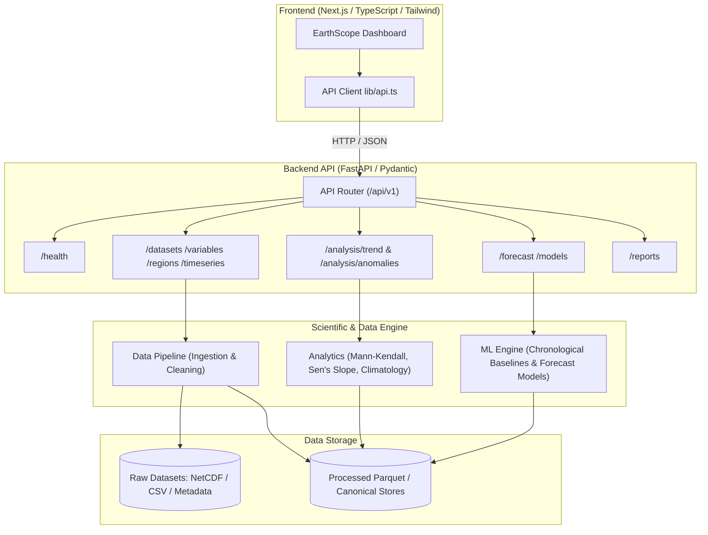

# EarthScope Architecture & Technology Stack

## 1. System Overview

EarthScope is structured into three strictly decoupled layers:
1. **Frontend Presentation Layer:** Next.js (React, TypeScript, Tailwind CSS) providing responsive visualization, interactive exploration, and findings export.
2. **Backend API & Orchestration Layer:** FastAPI application exposing RESTful endpoints, validating requests via Pydantic, and orchestrating scientific pipelines.
3. **Scientific Engine & Data Pipeline:** Python data processing (Pandas, NumPy, Xarray/HDF5), statistical trend detection (Mann-Kendall, Sen's slope, seasonal regression), and chronological ML forecasting.



---

## 2. Directory Layout & Module Responsibilities

```text
Earth-System-Trend-Detective/
├── backend/
│   ├── app/
│   │   ├── api/
│   │   │   └── v1/
│   │   │       ├── endpoints/
│   │   │       │   └── health.py
│   │   │       └── router.py
│   │   ├── core/
│   │   │   └── config.py
│   │   ├── schemas/
│   │   │   ├── health.py
│   │   │   ├── dataset.py
│   │   │   ├── timeseries.py
│   │   │   ├── trend.py
│   │   │   ├── forecast.py
│   │   │   └── error.py
│   │   └── main.py
│   ├── data_pipeline/
│   │   ├── ingestion/
│   │   ├── validation/
│   │   ├── preprocessing/
│   │   └── aggregation/
│   ├── analytics/
│   │   ├── eda/
│   │   ├── trend_detection/
│   │   └── anomaly_detection/
│   ├── ml/
│   │   ├── features/
│   │   ├── training/
│   │   ├── evaluation/
│   │   └── inference/
│   ├── tests/
│   │   ├── test_health.py
│   │   └── test_schemas.py
│   └── requirements.txt
├── datasets/                             # User-supplied raw Giovanni datasets (read-only)
├── data/
│   ├── raw/
│   ├── interim/
│   ├── processed/
│   ├── metadata/
│   └── models/          # joblib production forecast artifacts + manifest.json
├── frontend/
│   ├── app/
│   │   ├── globals.css
│   │   ├── layout.tsx
│   │   └── page.tsx
│   ├── lib/
│   │   └── api.ts
│   ├── package.json
│   ├── tailwind.config.js
│   └── tsconfig.json
├── docs/
├── pytest.ini
├── .env.example
└── README.md
```

---

## 3. Technology Selections and Rationale

| Layer | Technology | Selection Rationale |
|---|---|---|
| **Frontend Framework** | Next.js 14 (App Router) | Modern React server/client capabilities, fast development, clean routing. |
| **Styling** | Tailwind CSS | Utility-first CSS, consistent design tokens, dark mode support. |
| **Backend Framework** | FastAPI (Python 3.14) | High-performance asynchronous API, native Pydantic schema validation, automatic OpenAPI documentation. |
| **Tabular & Array Math** | Pandas, NumPy, SciPy | Scientific standard for time-series analysis, statistical tests, and numeric stability. |
| **Statistical Methods** | Mann-Kendall, Sen's Slope, OLS | Defensible non-parametric and parametric trend estimation with explicit assumptions. |
| **Forecasting** | Scikit-learn, Lagged Ridge/Ensembles | Reproducible out-of-sample evaluated models compared strictly against naive baselines without data leakage. |
| **Testing** | Pytest, pytest-asyncio, Node smoke runner | Deterministic, automated validation runnable in local CLI and CI. |

---

## 4. Architectural Boundaries and Rules

1. **Zero Scientific Logic in the Frontend:** All unit conversions, statistical computations, p-values, anomalies, and model inferences occur in backend Python modules.
2. **Immutable Raw Data:** `datasets/` is strictly read-only. Cleaned outputs and aggregates are written to `data/processed/`.
3. **Structured API Schemas:** All requests and responses use explicit Pydantic schemas. Untyped dictionaries or arbitrary responses are forbidden.
4. **Transparent Provenance:** Every response containing environmental data carries physical units, time resolution, geographic scope, and data source citations.
