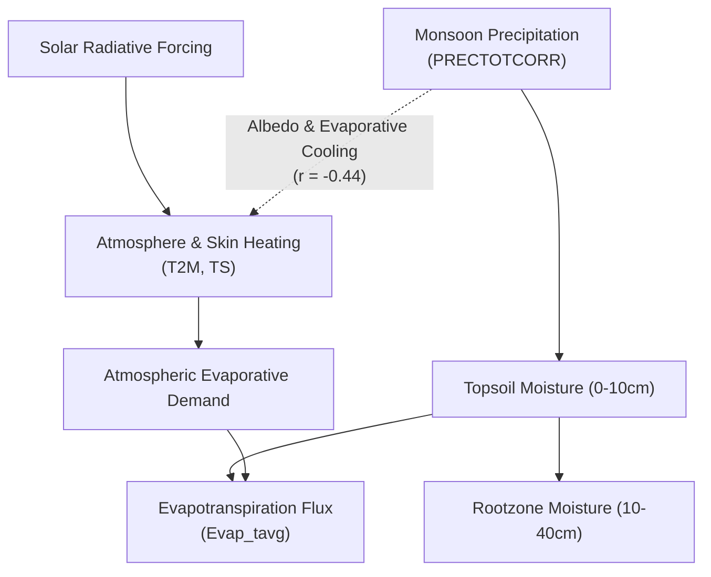

# Exploratory Data Analysis (EDA) Findings Report

**Project:** EarthScope (NASA Space Apps Challenge 2026)  
**Challenge:** "Be an Earth System Trend Detective!"  
**Region:** Pakistan (Area-Averaged, 23.31°N–37.69°N, 60.39°E–77.73°E)  
**Date of Audit:** 2026-11-14  
**Author:** EarthScope Data Science Team  

---

## 1. Executive Summary

This report synthesizes findings from exploratory data analysis of 25 years (2001–2025) of NASA MERRA-2 and GLDAS-2.1 monthly observations across 6 coupled hydrometeorological variables for Pakistan.



### Key Discoveries:
1. **Strong Non-Linearity & Seasonal Dominance:** All 6 variables exhibit pronounced 12-month periodicity. In unadjusted series, variables appear positively correlated due to shared summer peaks; however, **deseasonalized anomaly analysis reveals true physical couplings**.
2. **Water-Limited Evapotranspiration Regime:** In Pakistan's arid/semi-arid climate, monthly evapotranspiration anomalies correlate with topsoil moisture at **$r = +0.896$** ($r = +0.853$ with rootzone moisture). Evaporation is throttled by water availability rather than solar energy.
3. **Evaporative & Cloud Albedo Cooling:** Monsoon precipitation anomalies correlate negatively with air temperature anomalies ($r = -0.443$) and surface skin temperature anomalies ($r = -0.517$). Unusually wet months are significantly cooler than climatology.
4. **Empirical Verification of Historic Events:** The dataset reproduces the **August 2010 Indus super-floods**, the **2001–2002 nationwide drought**, the **April 2022 pre-monsoon heatwave** ($+2.36\sigma$), and the **catastrophic July–August 2022 flood disaster** (July rain $+11.59\sigma$, soil moisture and evapotranspiration all-time 25-year records).

---

## 2. Statistical Profiles of Variables

*(Computed over 300 months for T2M, TS, Evapotranspiration; 297 months for Precipitation, Soil Moisture)*

| Variable | Unit | Mean | Median | Std | Min | Max | Skewness | Kurtosis | Physical Profile |
|---|---|---|---|---|---|---|---|---|---|
| **2m Air Temp (`t2m`)** | °C | 21.13 | 22.84 | 7.57 | 6.37 | 31.19 | -0.34 | -1.16 | Symmetric, bimodal seasonal |
| **Skin Temp (`ts`)** | °C | 21.94 | 24.32 | 8.86 | 5.63 | 33.91 | -0.35 | -1.21 | Higher amplitude than T2M |
| **Precipitation** | mm/mo | 27.13 | 16.51 | 31.89 | 0.04 | 254.30 | **+3.32** | **+15.65**| Extreme positive skewness |
| **Evapotranspiration** | mm/mo | 26.47 | 22.95 | 15.76 | 4.58 | 85.68 | +1.34 | +1.98 | Right-skewed, monsoon pulse |
| **Soil Moisture (0–10cm)** | kg/m² | 16.97 | 16.03 | 3.03 | 10.89 | 28.00 | +0.77 | +0.65 | Moderate skew, seasonal |
| **Soil Moisture (10–40cm)**| kg/m² | 65.72 | 64.91 | 5.13 | 53.95 | 87.66 | +0.94 | +1.73 | High inertial persistence |

### Distribution Observations:
- **Precipitation Non-Normality:** Precipitation shows extreme positive skewness ($+3.32$) and heavy kurtosis ($+15.65$), driven by episodic monsoon bursts where a single month (e.g. August 2022: $254.3\text{ mm}$) exceeds the annual median ($16.5\text{ mm/month}$) by more than 15-fold. **Standard OLS regression on raw precipitation will be heavily distorted by outliers; non-parametric Mann-Kendall and Sen's slope estimators are scientifically required.**
- **Thermal Regimes:** Both air and surface temperatures exhibit platykurtic ($k \approx -1.2$) bimodal distributions corresponding to distinct winter (Dec–Feb, means $6^\circ\text{C}$–$12^\circ\text{C}$) and summer (May–Jul, means $28^\circ\text{C}$–$31^\circ\text{C}$) states.

---

## 3. Climatological Annual Cycles (2001–2020 Baseline)

| Month | T2M (°C) | TS (°C) | Precipitation (mm/mo) | Evapotranspiration (mm/mo) | Soil Moisture 0–10cm (kg/m²) | Soil Moisture 10–40cm (kg/m²) | Season Phase |
|---|---|---|---|---|---|---|---|
| **Jan** | 9.04 | 8.14 | 14.69 | 12.62 | 16.56 | 62.53 | Winter (DJF) |
| **Feb** | 11.81 | 11.50 | 23.66 | 19.54 | 18.14 | 64.44 | Winter (DJF) |
| **Mar** | 17.33 | 17.74 | 29.17 | 28.13 | 17.98 | 64.59 | Pre-Monsoon (MAM) |
| **Apr** | 23.16 | 24.46 | 20.91 | 28.21 | 17.36 | 64.79 | Pre-Monsoon (MAM) |
| **May** | 28.18 | 30.03 | 12.59 | 24.96 | 15.54 | 63.81 | Pre-Monsoon (MAM) |
| **Jun** | 30.55 | 32.88 | 19.82 | 26.68 | 15.55 | 63.53 | Monsoon onset (JJAS) |
| **Jul** | 30.24 | 32.90 | 48.34 | 43.39 | 18.42 | 68.05 | Peak Monsoon (JJAS) |
| **Aug** | 28.75 | 31.02 | 47.46 | 51.49 | 19.88 | 71.75 | Peak Monsoon (JJAS) |
| **Sep** | 26.62 | 28.59 | 24.44 | 38.48 | 17.80 | 70.83 | Retreating Monsoon |
| **Oct** | 21.82 | 22.84 | 6.74 | 22.80 | 14.50 | 66.08 | Post-Monsoon (ON) |
| **Nov** | 15.65 | 15.28 | 6.27 | 13.91 | 14.47 | 64.52 | Post-Monsoon (ON) |
| **Dec** | 10.86 | 9.71 | 9.27 | 10.96 | 15.40 | 63.15 | Winter (DJF) |

### Seasonal Rhythm Insights:
1. **Thermal Lead & Monsoon Lag:** Temperatures peak in **June** (Air: $30.55^\circ\text{C}$, Skin: $32.88^\circ\text{C}$), whereas monsoon precipitation peaks in **July–August** ($48.3\text{ mm}$ and $47.5\text{ mm}$).
2. **Hydrological Delay:** Soil moisture in the top layer peaks in **August** ($19.88\text{ kg/m}^2$), while rootzone soil moisture reaches maximum storage in **August–September** ($71.75\text{ kg/m}^2$), reflecting vertical percolation lag times.
3. **October–November Dry Window:** October and November are the driest months nationwide ($< 7\text{ mm/month}$ average), leading to steady depletion of topsoil moisture prior to winter western disturbances.

---

## 4. Cross-Variable Physical Couplings

### 4.1 Comparison: Observed Values vs Deseasonalized Anomalies

| Pair | Raw Value Pearson $r$ | Anomaly Pearson $r$ | Scientific Physical Interpretation |
|---|---|---|---|
| **T2M vs TS** | **+0.999** | **+0.977** | Extremely tight thermodynamic equilibrium between surface skin and air. |
| **T2M vs Precip** | +0.268 (Artefact) | **-0.443** | In raw data, both peak in summer; in anomalies, high rain brings strong cooling. |
| **TS vs Precip** | +0.272 (Artefact) | **-0.517** | Rain wetness and cloud shade strongly reduce ground skin temperatures. |
| **Precip vs Evap** | +0.714 | **+0.666** | Direct water supply expands latent heat flux and evapotranspiration. |
| **Precip vs Soil 0-10cm** | +0.666 | **+0.588** | Precipitation directly infiltrates surface soil layer. |
| **Soil 0-10cm vs Evap** | +0.796 | **+0.896** | **Dominant terrestrial coupling:** Evapotranspiration is water-limited. |
| **Soil 0-10cm vs 10-40cm**| +0.841 | **+0.868** | Strong hydraulic gradient and downward drainage into root zone. |

---

## 5. Case Studies: Historical Extreme Events

```text
┌─────────────────────────────────────────────────────────────────────────────┐
│ 1. THE AUGUST 2022 CATACLYSMIC FLOOD DISASTER                               │
├─────────────────────────────────────────────────────────────────────────────┤
│ • Precipitation: 254.30 mm/mo (+206.84 mm anomaly, +6.40σ)                  │
│ • July 2022 Pre-Storm: 251.51 mm/mo (+203.17 mm anomaly, +11.59σ)           │
│ • Air Temp Anomaly: -3.07 °C (-5.36σ colder than climatology)               │
│ • Skin Temp Anomaly: -4.57 °C (-5.68σ colder than climatology)              │
│ • Topsoil Moisture: 28.00 kg/m² (+8.12 kg/m² anomaly, 25-year maximum)      │
│ • Evapotranspiration: 85.68 mm/mo (+34.19 mm anomaly, 25-year maximum)      │
│ Significance: Validates the dual-month rainfall anomaly that submerged one- │
│ third of Pakistan and displaced 33 million people.                          │
└─────────────────────────────────────────────────────────────────────────────┘

┌─────────────────────────────────────────────────────────────────────────────┐
│ 2. THE 2001–2002 HISTORIC NATIONWIDE DROUGHT                                │
├─────────────────────────────────────────────────────────────────────────────┤
│ • July 2002 Precipitation: 8.33 mm/mo (-40.01 mm anomaly, -2.28σ)           │
│ • Topsoil Moisture (Feb 2001): 12.53 kg/m² (-5.61 kg/m² anomaly, min)       │
│ • Rootzone Moisture (Mar 2001): 53.95 kg/m² (-10.64 kg/m² anomaly, min)     │
│ Significance: Demonstrates multi-season moisture deficit and prolonged      │
│ agricultural drought across the Indus Basin.                                │
└─────────────────────────────────────────────────────────────────────────────┘

┌─────────────────────────────────────────────────────────────────────────────┐
│ 3. THE MARCH–APRIL 2022 PRE-MONSOON RECORD HEATWAVE                         │
├─────────────────────────────────────────────────────────────────────────────┤
│ • April 2022 Air Temp: 25.88 °C (+2.72 °C anomaly, +2.36σ)                  │
│ • March 2022 Air Temp: 20.40 °C (+3.07 °C anomaly, +1.92σ)                  │
│ Significance: The unprecedented early heatwave accelerated glacial melt in  │
│ northern basins prior to the catastrophic monsoon influx.                    │
└─────────────────────────────────────────────────────────────────────────────┘
```

---

## 6. Strategic Methodological Directives

### Directives for Stage 4 (Statistical Trend Detection):
1. **Deseasonalization is Mandatory:** Standard linear regressions run on raw monthly observations conflate seasonal variance with long-term climate trends. Analysis must evaluate deseasonalized anomalies or use Seasonal Mann-Kendall.
2. **Robust Estimators for Precipitation:** Because precipitation exhibits high positive skewness ($+3.32$) and extreme kurtosis ($+15.65$), OLS slopes will be unduly sensitive to single extreme months (like 2022). **Sen's non-parametric slope estimator is required** to determine true median trend magnitude.
3. **Autocorrelation Correction:** Soil moisture exhibits high month-to-month persistence ($r_{t, t-1} > 0.8$). Trend significance tests on soil moisture must apply **pre-whitening or Yue-Pilon modified Mann-Kendall** to prevent false-positive trend detections.

### Directives for Stage 5 (Forecasting):
1. **Strong Benchmark Hierarchy:** All predictive models must be evaluated against **Seasonal Naive** (repeating previous year's month) and **Lag-1 Persistence**, evaluated chronologically on out-of-sample holdout test sets.
2. **Feature Engineering from Coupled Dynamics:**
   - Evapotranspiration forecasts should incorporate lagged soil moisture features (due to $r = +0.896$ coupling).
   - Temperature forecasts should utilize seasonal trigonometric features and lagged anomalies.
