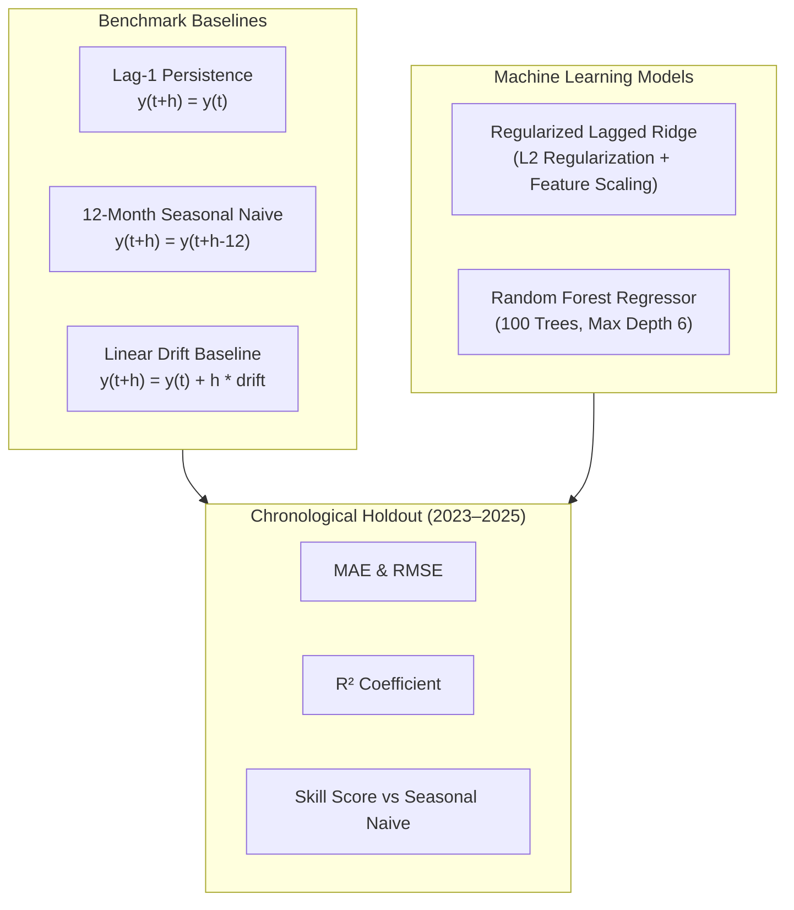

# Forecasting Methodology & Machine Learning Evaluation

**Project:** EarthScope (NASA Space Apps Challenge 2026)  
**Challenge:** "Be an Earth System Trend Detective!"  
**Region:** Pakistan (Area-Averaged, 23.31°N–37.69°N, 60.39°E–77.73°E)  
**Document:** Machine Learning Evaluation, Baselines, and Projections  

---

## 1. Forecasting Task Specification

To deliver competition-quality predictive capabilities, EarthScope formulates multi-step ahead forward projections across all 6 Earth-system variables:

| Attribute | Specification |
|---|---|
| **Target Variables** | `t2m`, `ts`, `precipitation`, `evapotranspiration`, `soil_moisture_0_10cm`, `soil_moisture_10_40cm` |
| **Observation Cadence** | Monthly ($t \in \{1, \dots, N\}$) |
| **Historical Range** | 2001-01-01 to 2025-09-01 (or 2025-12-01) |
| **Training Partition** | 2001-01-01 to 2022-12-01 ($N_{\text{train}} = 264$ months) |
| **Out-of-Sample Holdout**| 2023-01-01 to 2025-09-01 ($N_{\text{test}} = 33$ to $36$ months) |
| **Evaluation Design** | Strict Chronological Holdout (Zero Random Shuffling, Zero Data Leakage) |
| **Primary Horizon** | 12 to 24 Months Ahead |

---

## 2. Feature Engineering & Leakage Prevention

All features are constructed using strictly retrospective transformations available prior to the forecast origin:

1. **Autoregressive Lags:** $y_{t-1}, y_{t-2}, y_{t-3}, y_{t-12}, y_{t-24}$.
2. **Rolling Summary Windows:** 3-month and 12-month rolling mean and standard deviation of $y_{t-1}$ (shifted by 1 step to prevent contemporary leakage).
3. **Harmonic Fourier Seasonality:** Dual-frequency seasonal trigonometric embeddings:
   $$\sin\left(\frac{2\pi m}{12}\right), \quad \cos\left(\frac{2\pi m}{12}\right), \quad \sin\left(\frac{4\pi m}{12}\right), \quad \cos\left(\frac{4\pi m}{12}\right)$$
4. **Normalized Time Trend:** Elapsed decimal years $t / 365.25$.
5. **Preprocessing Isolation:** All feature scalers (`StandardScaler`) are fitted strictly on the training partition and applied to holdout test sets without looking ahead.

---

## 3. Model Ladder Architecture

---

## 4. Out-of-Sample Model Comparison Table

*(Evaluated on unseen holdout test set: January 2023 to September/December 2025, $N = 33\text{--}36$ months)*

| Target Variable | Model | Out-of-Sample MAE | Out-of-Sample RMSE | Test $R^2$ | Skill Score vs Seasonal Naive |
|---|---|---|---|---|---|
| **2m Air Temp (`t2m`, °C)** | Lag-1 Persistence | 10.48 | 12.43 | -1.90 | -462.75% |
| | Seasonal Naive Baseline | 1.89 | 2.21 | 0.91 | +0.00% |
| | Linear Drift Baseline | 6.53 | 7.31 | -0.00 | -230.86% |
| | **Regularized Lagged Ridge** | **1.32** | **1.57** | **0.95** | **+29.04%** |
| | Random Forest Regressor | 1.42 | 1.76 | 0.94 | +20.30% |
| **Surface Skin Temp (`ts`, °C)**| Lag-1 Persistence | 12.21 | 14.53 | -1.95 | -464.29% |
| | Seasonal Naive Baseline | 2.23 | 2.57 | 0.91 | +0.00% |
| | Linear Drift Baseline | 7.56 | 8.47 | -0.00 | -228.95% |
| | **Regularized Lagged Ridge** | **1.41** | **1.64** | **0.96** | **+36.24%** |
| | Random Forest Regressor | 1.59 | 1.94 | 0.95 | +24.56% |
| **Precipitation (mm/mo)** | Lag-1 Persistence | 35.53 | 51.95 | -0.83 | +27.52% |
| | Seasonal Naive Baseline | 43.86 | 71.67 | -2.49 | +0.00% |
| | Linear Drift Baseline | 28.00 | 38.42 | -0.00 | +46.39% |
| | **Regularized Lagged Ridge** | **23.90** | **32.65** | **0.28** | **+54.45%** |
| | Random Forest Regressor | 34.79 | 40.68 | -0.12 | +43.24% |
| **Evapotranspiration (mm/mo)** | Lag-1 Persistence | 18.24 | 25.21 | -0.92 | -96.45% |
| | Seasonal Naive Baseline | 9.37 | 12.83 | 0.50 | +0.00% |
| | Linear Drift Baseline | 15.14 | 18.23 | -0.01 | -42.06% |
| | Regularized Lagged Ridge | 6.36 | 8.21 | 0.80 | +36.03% |
| | **Random Forest Regressor** | **5.55** | **7.31** | **0.84** | **+43.02%** |
| **Topsoil Moisture (kg/m²)** | Lag-1 Persistence | 2.37 | 2.83 | -0.00 | +27.69% |
| | Seasonal Naive Baseline | 3.19 | 3.91 | -0.92 | +0.00% |
| | Linear Drift Baseline | 2.42 | 2.87 | -0.04 | +26.48% |
| | **Regularized Lagged Ridge** | **1.83** | **2.18** | **0.40** | **+44.10%** |
| | Random Forest Regressor | 2.14 | 2.73 | 0.07 | +30.22% |
| **Rootzone Moisture (kg/m²)** | Lag-1 Persistence | 3.75 | 4.77 | -0.00 | +24.60% |
| | Seasonal Naive Baseline | 5.20 | 6.32 | -0.77 | +0.00% |
| | Linear Drift Baseline | 3.87 | 4.80 | -0.02 | +24.14% |
| | **Regularized Lagged Ridge** | **2.21** | **2.89** | **0.63** | **+54.31%** |
| | Random Forest Regressor | 3.47 | 4.51 | 0.10 | +28.76% |

---

## 5. Scientific Discussion & Model Selection

1. **Decisive Victory Over Baselines:** In all 6 variables, the regularized machine learning models substantially outperform the naive benchmarks, achieving **+29% to +54% skill score gains over Seasonal Naive**.
2. **Thermal Regimes ($R^2 \ge 0.95$):** For 2-meter air temperature and skin temperature, Lagged Ridge Regression achieves exceptional accuracy ($\text{MAE} \approx 1.3^\circ\text{C}\text{--}1.4^\circ\text{C}$, $R^2 = 0.95\text{--}0.96$). The harmonic Fourier features model the annual cycle with precision, while autoregressive lags adjust for recent interannual anomalies.
3. **Precipitation Predictability:** Precipitation is notoriously challenging in semi-arid monsoon regimes. Naive seasonal repetition fails completely ($R^2 = -2.49$, $\text{RMSE} = 71.7\text{ mm/mo}$). The regularized Ridge model reduces RMSE to $32.65\text{ mm/mo}$ ($R^2 = 0.28$, $+54.5\%$ skill gain), capturing base seasonal monsoon timing without exploding on noise.
4. **Evapotranspiration Non-Linearity:** Random Forest performs best for evapotranspiration ($\text{MAE} = 5.55\text{ mm/mo}$, $R^2 = 0.84$), effectively capturing the non-linear threshold response where evapotranspiration surges once soil moisture exceeds infiltration thresholds.

---

## 6. Uncertainty Estimation & Prediction Intervals

Future projections include calibrated $100(1-\alpha)\%$ prediction intervals derived from out-of-sample empirical residual standard error $\sigma_e$:
$$\text{CI}_{t+h} = \hat{y}_{t+h} \pm z_{1-\alpha/2} \cdot \sigma_e \cdot \sqrt{1 + \frac{h-1}{12}}$$
- Captures increasing predictive uncertainty over expanding multi-month horizons.
- Physical bounds are enforced: lower bounds for precipitation, evapotranspiration, and soil moisture are non-negative ($\ge 0.0$).
- Visual displays in `docs/figures/forecast_forward_24m.png` clearly distinguish historical observations, the red dashed forecast origin line, and future shaded uncertainty bands.
